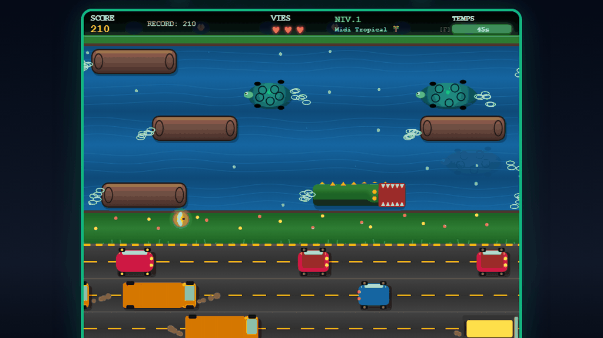

# Coâ Coâ Express

**La traversée qui pique. Route, puis rivière, sans finir écrasé ni noyé.**

Joue ici : [games.hylst.fr/coacoaexpress/](https://games.hylst.fr/coacoaexpress/)



## Comment on joue

Traversez la route en évitant les voitures, camions et bulldozers, puis la rivière en
sautant de rondin en tortue (attention, certaines plongent), jusqu'aux nénuphars du haut.
Remplissez les 6 nénuphars pour terminer le niveau. Chaque niveau accélère la circulation
et change de décor.

Les caïmans se font passer pour des rondins jusqu'à ce que leur gueule s'ouvre. Les mouches
dorées rapportent des points, à la langue (à distance) ou juste en passant à côté.

## Contrôles

| Action | Touche |
|--------|--------|
| Sauter | Flèches ou ZQSD |
| Tirer la langue (manger une mouche à distance) | E ou Espace |
| Démarrer / relancer | Espace ou Entrée |

## Ce qu'il y a dedans

- 10 thèmes visuels qui défilent d'un niveau à l'autre (tropical, arctique, cyberpunk,
  nucléaire, sucreries...)
- Rondins, tortues plongeantes, caïmans à gueule piégeuse
- Voitures, camions, bulldozers, voitures de police avec gyrophare
- Combos et bonus de temps à chaque nénuphar rempli, vie bonus tous les 3000 points
- Mouches dorées à gober au vol
- Musique chiptune procédurale qui s'accélère quand le temps presse

## L'arborescence

```
coa-coa-express-game-development/
├── index.html          # template + bloc SEO
├── vite.config.ts      # base '/coacoaexpress/' + singlefile
├── public/
│   ├── favicon.png
│   ├── og-image.png / og-image.webp
│   └── icon.webp        # carte du menu, 128x128
└── src/
    ├── main.tsx
    ├── App.tsx
    └── game/
        ├── Frogger.tsx      # rendu Canvas 2D, HUD, ecrans
        ├── useGameLoop.ts   # LOGIQUE PURE : reducteur, IA, collisions
        ├── constants.ts     # dimensions, vitesses, themes
        ├── types.ts
        └── audio.ts         # synthese Web Audio
```

## Dev

```bash
npm install
npm run dev       # http://localhost:5173/coacoaexpress/
npm run build     # dist/index.html, un seul fichier
npm run preview
```

## Stack

React 19, TypeScript 5.9 (strict), Tailwind CSS 4, Vite 7, vite-plugin-singlefile.

Zéro backend, zéro sprite : tout est dessiné en Canvas 2D, les sons sont synthétisés au vol.

## Licence

MIT, Geoffroy Streit (Hylst)
